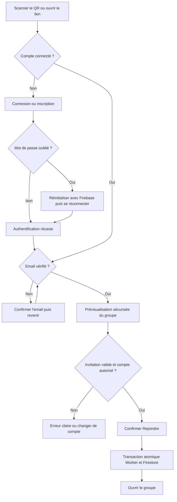

# OurFinance — Invitations de groupe par QR code et lien sécurisé (V1)

**Décision produit : 16 novembre 2026.** Référence complémentaire à [PLAN_TECHNIQUE_V1.md](PLAN_TECHNIQUE_V1.md) et [DESIGN_EVERYDAY_POP.md](DESIGN_EVERYDAY_POP.md). **Spécification fonctionnelle et technique ; aucune implémentation n'est revendiquée par ce document.**

## 1. Objectif et règle de base

Un propriétaire de groupe peut inviter une personne à rejoindre son groupe **en affichant un QR code à scanner**, ou en partageant le **même lien sécurisé** par copie, messagerie, partage natif ou `mailto:`. Le QR code est **une représentation du lien d'invitation**, pas un second mécanisme d'accès. Le scan avec l'appareil photo natif d'un téléphone ouvre la PWA OurFinance en HTTPS, même si elle n'est pas installée.

- Le QR code **n'authentifie pas** l'invité et ne donne pas accès aux données du groupe avant son acceptation autorisée.
- **V1 : seul le propriétaire** peut créer, consulter les liens/QR actifs et révoquer des invitations. Ne pas confondre avec les catégories personnalisées, que tous les membres actifs peuvent gérer. Délégation d'invitation éventuelle en V2.
- Une invitation QR/lien est **à usage unique pour un nouvel adhérent**. Pour inviter plusieurs personnes, créer une invitation distincte pour chacune. La page doit le signaler clairement.
- Par défaut, validité **24 heures**, avec choix éventuel 1 h / 24 h / 7 jours, maximum 7 jours, configuré côté serveur ; date d'expiration visible dans l'interface. Les valeurs restent à confirmer par tests et revue sécurité.
- Deux modes : **invitation ouverte** (QR partageable sans email, la première personne éligible qui l'accepte devient membre) et **invitation ciblée** (email renseigné, seul un compte avec cet email **vérifié** peut accepter). Présenter explicitement le risque de transfert ou photographie d'un QR ouvert.
- Le nouvel adhérent reçoit le rôle `member` et **n'obtient jamais** `owner` par invitation. Aucune dette, dépense ou partage par défaut ne lui est attribué rétroactivement ; l'historique comptable et les préférences des autres membres restent intacts.
- Après l'acceptation, rediriger vers le groupe concerné et sa devise unique. Aucune invitation ne modifie la devise du groupe.

## 2. Bibliothèque Angular de génération

**Choix recommandé : [`angularx-qrcode`](https://github.com/Cordobo/angularx-qrcode)**, bibliothèque Angular existante avec composant standalone, génération locale, support d'accessibilité et export d'image. La documentation du dépôt annonce Angular 22 et un mapping des versions majeures.

- Utiliser une version **compatible avec le major Angular réellement installé** ; ne pas forcer une mise à niveau Angular pour ajouter le QR. Vérifier `peerDependencies`, licence, maintenance, vulnérabilités, poids du bundle et tests avant d'installer.
- Générer le QR **côté navigateur** à partir de l'URL HTTPS d'invitation fournie par le backend, sans service QR externe ni envoi de la donnée à un générateur distant.
- Réutiliser un composant standalone `InviteQrCode` sous `src/app/shared/components/`, utilisant `angularx-qrcode` ; afficher une taille confortable (~240–280 px), fond clair, contraste fort, marge de silence, texte alternatif accessible, bouton copier le lien, partage natif si disponible et téléchargement PNG facultatif.
- Le style **Everyday Pop** peut habiller la modale, mais ne doit **pas** altérer la lisibilité du QR avec une illustration, un logo couvrant les modules, un dégradé insuffisamment contrasté ou une animation.
- **Pas de lecteur de QR intégré requis en V1** : l'appareil photo du téléphone ouvre l'URL. Si un scan depuis l'application est demandé plus tard, évaluer `@zxing/browser` ou une bibliothèque Angular maintenue, avec permission caméra explicite, repli manuel et tests iOS/Android.

## 3. URL, jeton et confidentialité

- URL HTTPS du domaine de l'environnement actif, par exemple `https://app.example.com/join#invite=<opaqueToken>` ; l'exemple est **fictif**. Le fragment URL limite l'envoi automatique du jeton dans la requête HTTP initiale, mais **n'est pas une garantie de confidentialité** contre scripts, captures, historique, presse-papiers ou partage.
- `opaqueToken` = valeur aléatoire cryptographiquement sûre (**au moins 128 bits d'entropie**, idéalement 192/256), **pas** un `groupId`, email, UID, JWT permanent ou donnée financière. L'URL ne contient ni nom de groupe ni email.
- Le frontend capture le fragment dès l'arrivée, valide la forme, conserve temporairement le jeton **dans `sessionStorage`** uniquement pour traverser login/inscription/réinitialisation, puis retire immédiatement le fragment de l'URL via `history.replaceState`. Effacer la valeur après acceptation, refus, expiration ou annulation explicite. Ne jamais persister le jeton dans Firestore client, `localStorage`, logs, analytics, outils d'erreurs ou liens `continueUrl` de Firebase.
- Le backend ne conserve **que le hash** du jeton, jamais sa valeur brute, avec expiration, statut, `createdBy`, email cible facultatif, `acceptedBy`, `acceptedAt`, `revokedAt` et compteur d'utilisations maximal = 1. L'invitation est associée au groupe côté serveur.
- Les appels serveur sont authentifiés avec un **Firebase ID token** valide. Ne pas exposer le nom du groupe ni la liste de membres à un visiteur non connecté ; avant login, afficher une page générique « Vous avez reçu une invitation ».
- Après authentification, le Worker vérifie l'invitation et retourne **uniquement** les informations nécessaires à la confirmation : nom/icône du groupe, devise et éventuellement propriétaire/description publique approuvée. Ne jamais renvoyer les transactions du groupe avant adhésion.
- Ajouter des protections `Referrer-Policy`, CSP, limitation de débit, validation stricte des URL d'origine, protections anti-énumération, refus de redirection vers un domaine arbitraire et aucun effet de bord sur un simple GET de prévisualisation.
- La validation et l'acceptation se font **côté Worker** via transaction Firestore atomique : jeton connu, non expiré, non révoqué, non utilisé, groupe actif, email cible vérifié si applicable, UID valide, absence de double appartenance, création du membre puis consommation du jeton. Les écritures directes client vers `invitations` et `members` sont interdites par les Security Rules, sauf opérations précisément autorisées par l'architecture existante et testées.
- Prévoir des **clés d'idempotence** ou une sémantique idempotente pour les doubles clics/retries ; une seule adhésion est créée même avec deux appareils scannant simultanément.
- Révoquer le QR ou supprimer le groupe invalide immédiatement les invitations en attente. Un membre retiré ne récupère pas l'accès avec un lien consommé ; il lui faut une nouvelle invitation.

## 4. Parcours utilisateur exhaustifs

| Situation au scan / ouverture du lien | Comportement attendu |
|---|---|
| **Compte existant, connecté, email vérifié, non membre** | Afficher la prévisualisation sécurisée du groupe, bouton **Rejoindre le groupe**, puis confirmation et navigation vers ce groupe. |
| **Compte existant, déconnecté** | Afficher une page d'accueil d'invitation, proposer **Se connecter** (email/mot de passe ou Google), conserver l'invitation pendant l'authentification, revenir à la confirmation. |
| **Compte existant, mot de passe oublié** | Bouton **Mot de passe oublié ?** → email Firebase Auth → réinitialisation → reconnexion → retour à l'invitation en attente et acceptation explicite. Si le mail est ouvert sur un autre appareil/onglet, proposer de **rouvrir le lien ou rescanner le QR** ; ne pas promettre la reprise automatique inter-appareils. |
| **Nouveau compte email/mot de passe** | **Créer un compte** → confirmation email Firebase → connexion → confirmation du groupe → adhésion. Pas d'adhésion avant email vérifié. |
| **Nouveau compte via Google** | Connexion/inscription Google → vérifier l'identité et l'email vérifié → retour à la confirmation → adhésion. Ne pas fusionner silencieusement des comptes existants. |
| **Compte connecté avec le mauvais utilisateur** | Indiquer quel compte est actif ; proposer **Changer de compte** sans perdre l'invitation dans la session. Pour une invitation ciblée, expliquer que l'email du compte ne correspond pas, sans révéler l'email cible en clair. |
| **Compte non vérifié** | Expliquer la nécessité de confirmer l'email, proposer **Renvoyer le lien** dans les limites Firebase, puis réévaluer l'invitation au retour. |
| **Utilisateur déjà membre** | Afficher **Vous faites déjà partie de ce groupe** et un lien pour l'ouvrir ; ne pas créer de doublon ni consommer une nouvelle invitation inutilement. |
| **Invitation expirée** | Afficher un état clair et demander un **nouveau QR/lien** au propriétaire ; ne pas accepter. |
| **Invitation révoquée** | Refuser et expliquer que le lien n'est plus valide, sans révéler de données privées. |
| **Invitation déjà utilisée par un tiers** | Refuser et demander une nouvelle invitation ; aucun accès au groupe. |
| **Invitation ciblée avec email différent** | Refuser l'adhésion ; proposer de se connecter au bon compte ou de demander une nouvelle invitation ciblée. |
| **Groupe archivé/supprimé ou propriétaire non autorisé** | Refuser, avec message générique et lien de retour aux groupes. |
| **Lien modifié/invalide ou code QR illisible** | Afficher un état d'erreur, offrir **Copier le lien** côté émetteur et **Réessayer** côté invité. |
| **Réseau indisponible / Firebase ou Worker indisponible** | Préserver l'invitation temporaire, afficher **Réessayer** ; ne jamais annoncer une adhésion réussie avant confirmation serveur. |
| **Double clic / deux scans simultanés** | Transaction atomique : une seule adhésion et une seule consommation ; l'autre client reçoit un résultat cohérent (déjà membre ou lien utilisé). |
| **Invité refuse / quitte la page** | Aucune adhésion, aucune consommation du jeton ; retour possible tant que l'invitation est valide. |
| **QR photographié ou transféré à quelqu'un d'autre** | Invitation ouverte : premier compte éligible qui accepte l'utilise ; invitation ciblée : email vérifié obligatoire. L'interface avertit l'émetteur de cette différence. |

### Parcours illustré (logique)

## 5. Écrans Everyday Pop — desktop et mobile

### Émetteur (propriétaire)

Depuis **Groupe → Membres → Inviter** :

1. Choix **QR code / Copier le lien / Partager** sur une même invitation ; possibilité de cibler une adresse email ou de créer un QR ouvert.
2. Modale ou panneau **Everyday Pop** : nom et icône du groupe, **QR très lisible**, durée restante, statut « Une personne », bouton copier, partager et régénérer, avertissement pour les QR ouverts.
3. **Desktop** : modal centré avec QR, détails et actions ; **mobile** : bottom sheet/page dédiée avec QR, zone de partage et bouton natif. Ne pas placer le QR sur un arrière-plan illustré ni le rogner.
4. Liste des invitations **En attente / Acceptée / Expirée / Révoquée**, sans afficher les jetons bruts après création ; révocation et création d'un nouveau QR. Une fois la modale fermée, si la valeur brute n'est plus disponible, générer un **nouveau** QR plutôt que tenter de récupérer le secret depuis Firestore.
5. Le groupe affiche son **unique devise** ; l'invitation ne permet pas de choisir une autre devise.

### Invité

1. Page d'accueil d'invitation **responsive** avec visuel Everyday Pop discret, texte internationalisé, boutons **Se connecter / Créer un compte**, et lien de récupération de mot de passe.
2. Après authentification : carte **Rejoindre [nom du groupe]**, devise et invitation, boutons **Rejoindre** / **Pas maintenant**, états de chargement, succès et erreur.
3. Sur mobile, garder le CTA visible sans masquer le contenu par la navigation basse ; sur desktop, modal/carte centrale. Aucun besoin d'installer la PWA pour accepter.
4. Traductions complètes **FR/EN/JA**, formats de date d'expiration locaux, navigation clavier, focus, lecteur d'écran, zoom, contraste et 320/390/768/1280 px.

## 6. Architecture / responsabilités

- **Angular** : `GroupInviteDialog`, `InviteQrCode`, `InviteLandingPage`, `InviteAcceptanceCard`, `PendingInviteService`, `GroupInvitationService`. Routes `/join`, authentification et reprise d'invitation ; code QR via `angularx-qrcode`.
- **Worker** (routes indicatives, adapter aux conventions API existantes) : `POST /groups/:groupId/invitations` (owner), `GET /invitations/preview` (authentifié, lecture sans consommation), `POST /invitations/accept` (authentifié + transaction), `POST /groups/:groupId/invitations/:id/revoke` (owner). Ne jamais mettre le jeton brut dans un segment de chemin ou une query d'une requête GET ; préférer un POST authentifié pour les opérations qui portent le secret, même pour une prévisualisation non mutante.
- **Firestore** : `groups/{groupId}/invitations/{invitationId}` avec `tokenHash`, `expiresAt`, `maxUses:1`, `status`, `targetEmailNormalized` facultatif, `createdBy`, `createdAt`, `acceptedBy`, `acceptedAt`, `revokedAt` ; `groups/{groupId}/members/{uid}` pour l'appartenance. Prévoir une recherche de hash efficace (index unique logique / identifiant dérivé) sans exposer la collection au client ; empêcher collisions et doublons dans la transaction.
- **Sécurité** : Firebase ID token vérifié, email vérifié, owner vérifié pour émission/révocation, droits IAM minimaux, refus inter-groupes, journal d'audit sans secrets, rate limiting, expiration et usage unique transactionnels.
- **Dépendances** : `angularx-qrcode` version compatible Angular ; **pas** de service SaaS QR, pas de backend QR dédié, pas de stockage Cloudinary pour le QR. La création du QR reste possible localement une fois l'URL d'invitation obtenue.

## 7. Tests / critères d'acceptation

- Tests unitaires du composant QR : lien exact de l'environnement, QR affiché, copie/partage, expiration et régénération, absence de requête à un service QR tiers.
- Tests de parcours E2E : utilisateur connecté, non connecté, nouvel utilisateur (email et Google), mot de passe oublié, email non vérifié, mauvais compte, email cible différent, déjà membre, refus, invitation expirée/révoquée/utilisée, QR réutilisé, groupe archivé, connexion interrompue.
- Tests de concurrence et Firestore Emulator : deux acceptations simultanées → **une seule** adhésion ; invitation non consommée lors de la simple consultation, des erreurs ou du refus ; aucun accès inter-groupes ; rôle `member` seulement.
- Tests de confidentialité : aucun jeton brut dans Firestore, logs, URL HTTP initiale, analytics, captures ou messages d'erreur ; lien de redirection contrôlé ; suppression du fragment URL après capture.
- Tests UI/UX Everyday Pop : mobile/desktop, QR scannable sur écran, option lien sans caméra, boutons 44×44 px, focus/lecteur d'écran, FR/EN/JA, 320/390/768/1280 px.
- La V1 reste compatible **Firebase Spark + Cloudflare Worker Free** sans ajouter de service payant ; valider les quotas réels du flux d'invitation.

## 8. Jalons et coordination

- **M1** : dépendance QR compatible Angular et composants partagés / route de landing, design Everyday Pop.
- **M2** : modèle Firestore, API Worker, création/révocation, tous les parcours auth + acceptation, écran membres/invitations, règles de sécurité et tests.
- **M6** : E2E multi-appareils, test caméra native iOS/Android, cas expirés/concurrents, a11y, FR/EN/JA, validation des quotas.
- Codex Cloud et local : **branches séparées**, relire `main` et les PR ouvertes, coordonner le périmètre ; ne pas fusionner automatiquement. Les captures personnelles Splitwise restent privées.

**Definition of Done** : un propriétaire crée un QR à usage unique, une personne le scanne avec son appareil photo, peut créer un compte ou se connecter (y compris après récupération du mot de passe), voit le groupe, confirme, devient membre **une seule fois** ; tous les cas de refus, expiration, révocation et sécurité sont testés.
