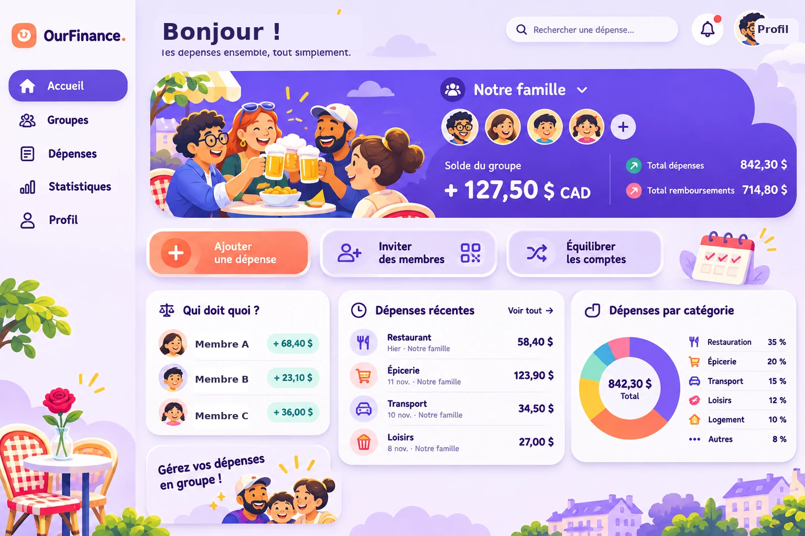
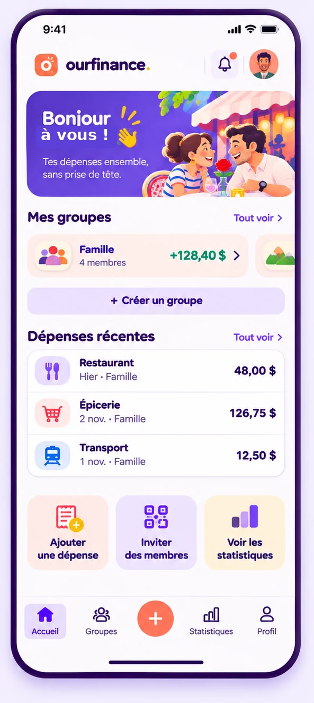
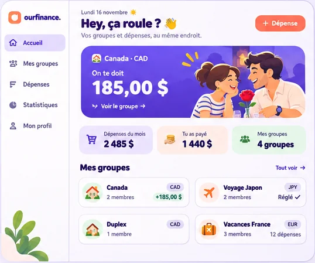
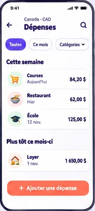
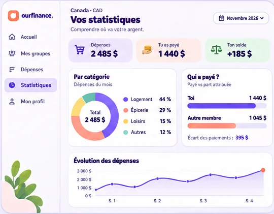
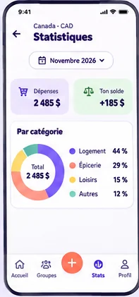

# OurFinance — Maquettes de référence approuvées (Everyday Pop)

**Référence visuelle pour Codex Cloud et Codex local.** Les huit images WebP de ce dossier sont des **découpes des maquettes Everyday Pop validées dans la conversation**, et non des captures de l'application réelle. Elles proviennent d'un montage illustrant quatre écrans en versions desktop et mobile. Elles contiennent uniquement des **données fictives**.

**Ne pas confondre** :
- `docs/design-references/*.webp` : **référence de composition des écrans complets** (navigation, hiérarchie, cartes, disposition, densité, CTA, illustrations).
- `public/illustrations/*.svg` : **assets vectoriels décoratifs** (terrasse de café, marque, catégories), à réutiliser dans l'application.
- Les **captures Splitwise privées** transmises séparément : références fonctionnelles uniquement, **jamais à committer**.

## Dernier choix validé : Everyday Pop V2 — priorité sur les anciennes maquettes Dashboard

La dernière direction choisie par l'utilisateur est **la DEUXIÈME proposition du 17 novembre 2026**, suivie de sa déclinaison **mobile où le couple apparaît avec une rose rouge**. Les maquettes ci-dessous ont été ajoutées après les huit références V1 et **priment en cas de divergence visuelle sur le Dashboard et sur la connexion mobile** :

| Écran | Référence V2 |
|---|---|
| **Dashboard avec groupes — desktop** |  |
| **Dashboard avec groupes — mobile** |  |
| **Connexion — mobile** |  |

**Vie privée** : les éventuels noms personnels présents dans les prototypes initiaux ont été remplacés par des libellés génériques avant leur ajout au dépôt public ; les avatars et montants sont fictifs. Ces trois images sont des **maquettes**, pas des captures d'une application fonctionnelle.

### Critères précis du Dashboard V2

**Desktop** : une navigation latérale persistante, en-tête accueillant avec recherche/profil, grande **carte héro violette** scindée entre une illustration **d'amis partageant un verre au café** et le **groupe actif** avec avatars et indicateurs comptables exacts. Sous cette carte : **trois grosses actions rapides** (Ajouter une dépense en corail, Inviter des membres avec QR, Équilibrer les comptes), puis **trois vrais panneaux financiers** : **Qui doit quoi ?**, **Dépenses récentes**, **Dépenses par catégorie avec graphique en anneau**. Illustrations florales/bistrot décoratives et palette violette/corail/lavande ; design convivial, pas un back-office austère.

**Mobile** : le haut de l'écran est une **bannière violette contenant le couple au café, une rose rouge et la table**. En dessous : **Mes groupes**, action Créer un groupe, **Dépenses récentes**, trois **raccourcis colorés** Ajouter/Inviter/Statistiques, et navigation basse à **cinq destinations** avec un bouton + central corail. Conserver une hauteur d'image raisonnable pour que les groupes et actions restent accessibles.

**Connexion mobile** : illustration immersive de terrasse comprenant **le groupe d'amis et le couple avec rose rouge**, bulles de catégories et devises sans texte, puis formulaire email/mot de passe, réinitialisation, CTA corail, Google et inscription. Pour desktop, conserver la composition à deux panneaux approuvée dans `connexion-desktop.webp`.

**Différences V2 importantes** : le couple est **assis à une table** sur le mobile ; sur desktop, la bannière principale privilégie le **groupe d'amis** et réserve une zone aux données et avatars ; ces deux compositions sont intentionnellement **distinctes**. Les illustrations `couple-cafe.webp`, `friends-celebrating.webp` ou `cafe-hero.webp` ne suffisent **pas** à elles seules pour démontrer la fidélité au design. Ne pas substituer un style **peint/photoréaliste** au rendu **vectoriel-cartoon lumineux** choisi, sauf validation explicite.

**Etat sans groupe** : ces deux nouvelles maquettes de Dashboard représentent un **compte avec groupes** ; elles ne doivent pas servir à afficher des montants fictifs quand aucun groupe n'existe. Conserver le parcours vide précédemment défini : navigation disponible, bannière soignée, CTA de création et étapes de découverte.

**Sémantique financière obligatoire** : la maquette fournit une composition, pas une formule comptable. Les totaux, balances, montants reçus et remboursés doivent être calculés avec les vrais services et la **devise unique du groupe**, sans addition entre devises ni montant hardcodé.

### Revue visuelle minimale pour Codex

Pour la PR #124 et toute suite UI, produire pour chaque état concerné une **capture réelle Playwright à 1280×800 desktop et 390×844 mobile** avec comptes et groupes fictifs ; fournir **une comparaison côte à côte entre chaque capture et cette V2**, signaler les écarts, les corriger et refaire des captures. **Ne pas déclarer la conformité visuelle sur la seule base d'un build vert, de tests unitaires ou de la présence des fichiers images**. Aucun merge ou déploiement sans validation explicite de l'utilisateur.

## Huit maquettes approuvées (références V1 secondaires si la V2 diffère)

| Écran | Desktop | Mobile |
|---|---|---|
| **Connexion** | [Voir la maquette](connexion-desktop.webp) | [Voir la maquette](connexion-mobile.webp) |
| **Dashboard / Groupes** | [Voir la maquette](groupes-dashboard-desktop.webp) | [Voir la maquette](groupes-dashboard-mobile.webp) |
| **Dépenses** | [Voir la maquette](depenses-desktop.webp) | [Voir la maquette](depenses-mobile.webp) |
| **Statistiques** | [Voir la maquette](statistiques-desktop.webp) | [Voir la maquette](statistiques-mobile.webp) |

### Connexion

### Dashboard / Groupes

### Dépenses

### Statistiques

## Comment utiliser ces références

1. **Ouvrir réellement les huit images** avant de coder, pas seulement lire leurs noms. Lire aussi `docs/DESIGN_EVERYDAY_POP.md`, `docs/PLAN_TECHNIQUE_V1.md` et `AGENTS.md`.
2. Créer de **vraies pages Angular Router** : Connexion, Dashboard, Groupes, Dépenses, Statistiques et Paramètres. **Ne pas** empiler les fonctionnalités dans un unique long template avec des liens `#anchor`.
3. Conserver le **shell authentifié** (sidebar desktop, navigation basse mobile) **même si `groups.length === 0`**. La maquette Dashboard montre un état **avec groupes** ; concevoir aussi un **état vide Everyday Pop** (illustration, message, CTA « Créer mon premier groupe ») sans soldes fictifs, sans masquer la navigation et sans formulaires empilés.
4. Conserver les **vraies données et règles métier** : groupe à devise unique, soldes exacts, répartition, invitation QR, Firebase, FR/EN/JA. Les montants et noms présents sur les maquettes sont fictifs, **jamais des valeurs à coder en dur**.
5. Comparer la **composition** (navigation, proportions, hiérarchie, cartes, illustration, typographie, couleurs, CTA, espaces, lisibilité), pas une égalité pixel à pixel : les images sont des maquettes conceptuelles recadrées et certaines micro-chaînes issues de génération d'image peuvent être approximatives. Le texte réel doit être traduit et correct.
6. **Validation obligatoire** pour chaque écran : lancer l'application, capturer avec **Playwright à 1280 × 800 desktop et 390 × 844 mobile**, comparer visuellement aux deux références, relever les écarts, corriger puis refaire les captures. Ajouter une capture **320 px** pour détecter les débordements et vérifier clavier/contraste.
7. Dans chaque PR UI, présenter **référence + capture réelle** pour chaque format, avec une liste des différences restantes. **Ne pas déclarer « terminé » parce que build/tests sont verts**. Ne pas fusionner/déployer sans validation visuelle du propriétaire.
8. Les captures de validation doivent utiliser des **comptes et données fictifs**. Aucune capture contenant des noms, emails, jetons ou dépenses réels dans GitHub, les PR ou les artefacts publics.

## État de référence et critères spécifiques

| Page | Comportements à respecter |
|---|---|
| **Connexion** | Desktop : illustration de café à gauche, formulaire à droite. Mobile : bandeau compact au-dessus du formulaire. Login, inscription, reset, Google, erreurs, email non vérifié, invitations en attente. |
| **Dashboard** | Navigation latérale / basse ; carte héro violette **du groupe actif** ; KPIs et groupes ; dépenses récentes ; **état vide sans groupe** avec CTA et navigation maintenue. Aucun total additionnant des devises différentes. |
| **Dépenses** | Page indépendante, historique avec catégories, ajout rapide desktop, création mobile dédiée, édition et cinq répartitions, devise du groupe imposée. |
| **Statistiques** | Page indépendante, KPI, anneau catégories, barres payé vs dû, évolution temporelle, **un dropdown** de période avec onglets Jours/Mois/Années. |

**Priorité en cas de conflit** : exactitude et sécurité métier > accessibilité et responsive > composition visuelle des maquettes > détail décoratif. Les maquettes servent de **référence obligatoire de direction UI**, pas de spécification des données financières.
