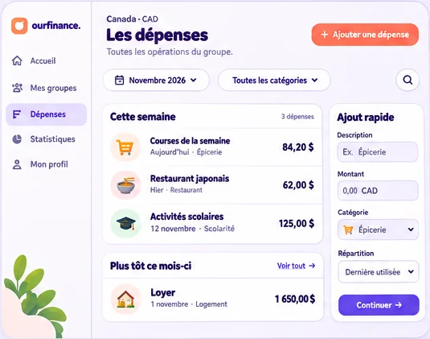

# OurFinance — Maquettes de référence approuvées (Everyday Pop)

**Référence visuelle pour Codex Cloud et Codex local.** Les huit images WebP de ce dossier sont des **découpes des maquettes Everyday Pop validées dans la conversation**, et non des captures de l'application réelle. Elles proviennent d'un montage illustrant quatre écrans en versions desktop et mobile. Elles contiennent uniquement des **données fictives**.

**Ne pas confondre** :
- `docs/design-references/*.webp` : **référence de composition des écrans complets** (navigation, hiérarchie, cartes, disposition, densité, CTA, illustrations).
- `public/illustrations/*.svg` : **assets vectoriels décoratifs** (terrasse de café, marque, catégories), à réutiliser dans l'application.
- Les **captures Splitwise privées** transmises séparément : références fonctionnelles uniquement, **jamais à committer**.

## Huit maquettes approuvées

| Écran | Desktop | Mobile |
|---|---|---|
| **Connexion** | [Voir la maquette](connexion-desktop.webp) | [Voir la maquette](connexion-mobile.webp) |
| **Dashboard / Groupes** | [Voir la maquette](groupes-dashboard-desktop.webp) | [Voir la maquette](groupes-dashboard-mobile.webp) |
| **Dépenses** | [Voir la maquette](depenses-desktop.webp) | [Voir la maquette](depenses-mobile.webp) |
| **Statistiques** | [Voir la maquette](statistiques-desktop.webp) | [Voir la maquette](statistiques-mobile.webp) |

### Connexion

### Dashboard / Groupes

### Dépenses

### Statistiques

## Comment utiliser ces références

1. **Ouvrir réellement les huit images** avant de coder, pas seulement lire leurs noms. Lire aussi `docs/DESIGN_EVERYDAY_POP.md`, `docs/PLAN_TECHNIQUE_V1.md` et `AGENTS.md`.
2. Créer de **vraies pages Angular Router** : Connexion, Dashboard, Groupes, Dépenses, Statistiques et Paramètres. **Ne pas** empiler les fonctionnalités dans un unique long template avec des liens `#anchor`.
3. Conserver le **shell authentifié** (sidebar desktop, navigation basse mobile) **même si `groups.length === 0`**. La maquette Dashboard montre un état **avec groupes** ; concevoir aussi un **état vide Everyday Pop** (illustration, message, CTA « Créer mon premier groupe ») sans soldes fictifs, sans masquer la navigation et sans formulaires empilés.
4. Conserver les **vraies données et règles métier** : groupe à devise unique, soldes exacts, répartition, invitation QR, Firebase, FR/EN/JA. Les montants et noms présents sur les maquettes sont fictifs, **jamais des valeurs à coder en dur**.
5. Comparer la **composition** (navigation, proportions, hiérarchie, cartes, illustration, typographie, couleurs, CTA, espaces, lisibilité), pas une égalité pixel à pixel : les images sont des maquettes conceptuelles recadrées et certaines micro-chaînes issues de génération d'image peuvent être approximatives. Le texte réel doit être traduit et correct.
6. **Validation obligatoire** pour chaque écran : lancer l'application, capturer avec **Playwright à 1280 × 800 desktop et 390 × 844 mobile**, comparer visuellement aux deux références, relever les écarts, corriger puis refaire les captures. Ajouter une capture **320 px** pour détecter les débordements et vérifier clavier/contraste.
7. Dans chaque PR UI, présenter **référence + capture réelle** pour chaque format, avec une liste des différences restantes. **Ne pas déclarer « terminé » parce que build/tests sont verts**. Ne pas fusionner/déployer sans validation visuelle du propriétaire.
8. Les captures de validation doivent utiliser des **comptes et données fictifs**. Aucune capture contenant des noms, emails, jetons ou dépenses réels dans GitHub, les PR ou les artefacts publics.

## État de référence et critères spécifiques

| Page | Comportements à respecter |
|---|---|
| **Connexion** | Desktop : illustration de café à gauche, formulaire à droite. Mobile : bandeau compact au-dessus du formulaire. Login, inscription, reset, Google, erreurs, email non vérifié, invitations en attente. |
| **Dashboard** | Navigation latérale / basse ; carte héro violette **du groupe actif** ; KPIs et groupes ; dépenses récentes ; **état vide sans groupe** avec CTA et navigation maintenue. Aucun total additionnant des devises différentes. |
| **Dépenses** | Page indépendante, historique avec catégories, ajout rapide desktop, création mobile dédiée, édition et cinq répartitions, devise du groupe imposée. |
| **Statistiques** | Page indépendante, KPI, anneau catégories, barres payé vs dû, évolution temporelle, **un dropdown** de période avec onglets Jours/Mois/Années. |

**Priorité en cas de conflit** : exactitude et sécurité métier > accessibilité et responsive > composition visuelle des maquettes > détail décoratif. Les maquettes servent de **référence obligatoire de direction UI**, pas de spécification des données financières.
