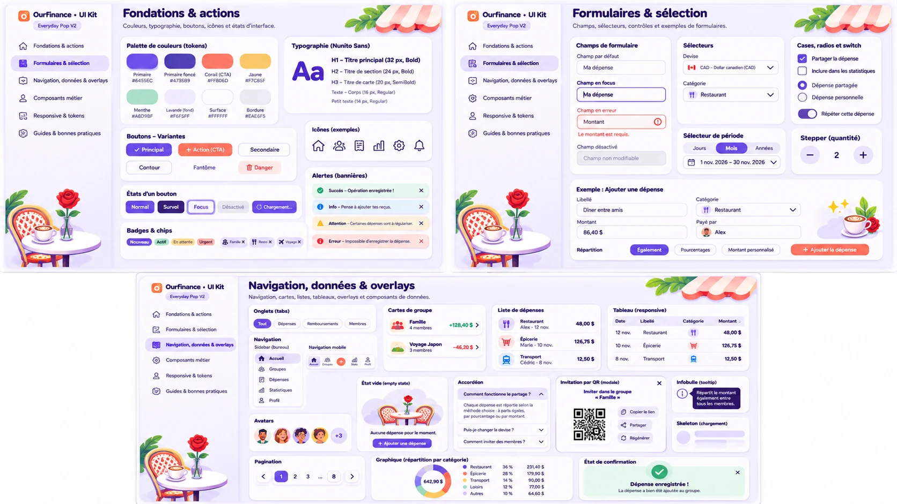
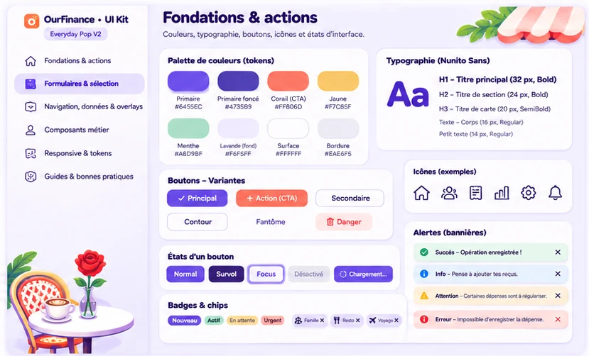
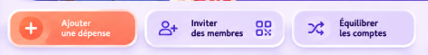
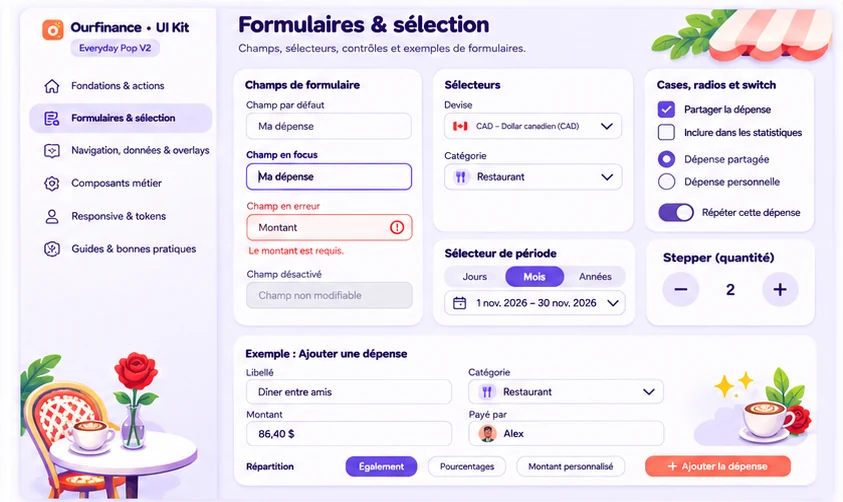
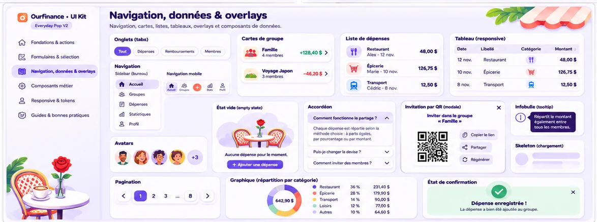

# OurFinance — UI Kit Everyday Pop V2

**Statut : référence visuelle prescriptive pour les composants génériques Angular.** Mise à jour du 17 novembre 2026, à partir de **l'image précise validée par l'utilisateur** (et non du prototype HTML précédent). Ce document décrit la **forme réelle des composants**, en complément de leur comportement : police, graisse, proportions, contours, espacement, densité, élévation et présentation.

> **RÈGLE PRIORITAIRE — respecter l'image, pas seulement les couleurs.** Le visuel ci-dessous est **la source de vérité graphique des composants**. Le précédent `docs/ui-kit/index.html` et ses six captures dans `screenshots/` ont été produits avant cette clarification : **ils ne sont pas des références de fidélité suffisantes** et doivent être corrigés / régénérés. Les maquettes d'écrans complets de `docs/design-references/` restent prioritaires pour la composition des pages Connexion, Dashboard, Dépenses et Statistiques. Ce UI Kit gouverne leur **langage commun de composants**.

## 1. Source visuelle approuvée : ouvrir les images, pas seulement ce texte



Le document original montre **trois planches** : deux tableaux supérieurs et un troisième tableau en dessous. Les trois découpes suivantes sont fournies **pour inspecter les détails à l'échelle naturelle** :

| Planche | Référence précise | À observer |
|---|---|---|
| **Fondations & actions** | [Voir la référence](visual-reference/reference-foundations-actions.webp) | Barre latérale, couleurs, titres, bordures de cartes, boutons, alertes, badges, icônes, rythme entre blocs |
| **Formulaires & sélection** | [Voir la référence](visual-reference/reference-forms-selection.webp) | Hauteurs et contours des champs, messages d'erreur, labels, selects, radios/switches, contrôle de période, formulaire de dépense |
| **Navigation, données & overlays** | [Voir la référence](visual-reference/reference-navigation-data-overlays.webp) | Densité des listes/tableaux, espacement des cartes, avatars, navigation, modal QR, graphique, pagination, skeleton et confirmation |

La référence a été redimensionnée/compressée **sans changement artistique** pour le dépôt. Les valeurs numériques ci-dessous sont des **cibles de réalisation** permettant à Codex de la reproduire ; ce ne sont pas des mesures métrologiques garanties du montage illustratif.

### Ce que l'image impose visuellement

- **Aspect** : produit financier joyeux, clair, moderne et soigné, **ni back-office générique ni interface enfantine**. Les surfaces blanches forment des panneaux distincts sur un fond lavande très léger ; les traits sont **fins**, les coins bien arrondis, les ombres presque invisibles.
- **Typographie** : titres en **Nunito Sans ExtraBold/Black**, arrondis, en **prune foncé** ; textes de formulaires et labels lisibles, pas de police système par défaut grossière, pas de caractères minces. Le rythme est **compact mais aéré à l'intérieur** des cartes.
- **Composition** : sidebar pâle relativement étroite, menu actif dans une pilule lavande, titre de la page en haut avec petite description, sections sous forme de **panneaux blancs rapprochés et alignés** dans une grille. Les panneaux ont un titre court et des contenus volontairement petits et bien organisés.
- **Bordures** : principalement **1 px lavande très clair** et une ombre douce ; **pas** de bordure violette épaisse autour de toutes les cartes. La bordure violette de **2 px est réservée au focus** ou à la sélection pertinente.
- **Couleur** : violet lumineux pour action principale/sélection, **corail** pour action métier forte (Ajouter), menthe pour succès, jaune pour attention, rouge doux pour erreur. Couleurs pastel sur les états et fonds secondaires ; texte foncé contrasté.
- **Détails illustrés** : le coin **bas gauche** de la page accueille une petite **table de bistrot à chaises tressées, rose rouge et tasse**, et le coin **haut droit** un petit **auvent blanc/corail et feuillage** ; ce sont des décors **limités aux pages de documentation / espaces de respiration**, pas un arrière-plan plein écran derrière les champs.
- **Pas de surcharge** : ni grands espaces vides entre chaque ligne, ni boutons géants partout, ni grosses icônes emoji hétérogènes, ni dégradés dans tous les panneaux. Les illustrations soutiennent le design sans remplacer le contenu.

### Direction artistique confirmée : une patte illustrée, pas un UI Kit « clinique »

**Clarification de l'utilisateur lors de la revue de la PR #137 :** le problème n'est pas seulement la police, les couleurs ou les dimensions. Le rendu de la PR est **trop propre / trop générique**, alors que l'image approuvée possède une **patte artistique visible**, plus chaleureuse, organique et légèrement artisanale. **Ne pas interpréter « moins propre » comme un manque de finition.**

| Référence Everyday Pop V2 | À éviter |
|---|---|
| **Illustrations dessinées** : petite terrasse de bistrot, rose rouge, tasse, chaises tressées, auvent corail, feuillage ; volumes arrondis, ombres colorées, légères irrégularités dans les contours **des illustrations** | Icônes plates ou décor vectoriel purement géométrique substitués aux scènes, grandes zones vides, illustration plaquée sans relation à la composition |
| **Profondeur douce** : panneaux blancs avec bordure lavande fine, ombre lilas presque imperceptible, détails légèrement superposés ou débordant dans des zones décoratives | Cartes uniformes `rounded-3xl p-5 shadow-sm` répétées partout, grosses bordures, ombres grises/noires standard |
| **Rythme éditorial vivant** : cartes de tailles adaptées à leur contenu, grilles compactes, alignements précis, éléments décoratifs asymétriques en périphérie | Longue pile de blocs identiques, espacements excessifs, colonnes sans hiérarchie, tout centré et symétrique |
| **Typographie ronde et expressive** : vraie **Nunito Sans chargée**, titres très gras, contraste de tailles et de poids, libellés compacts et lisibles | Police de secours malgré le CSS `font-family`, textes maigres ou petits, style système générique |
| **Couleurs nuancées** : violet/prune, lavande, corail, menthe ; quelques ombres et dégradés doux **dans les illustrations et les CTA** | Dégradés partout, couleurs saturées dans tous les champs, accumulation d'effets brillants |
| **Contrôles précis** : champs, listes, QR, graphiques et chiffres nets, accessibles, avec focus et validation clairs | Flou, texture, rotation, ombres lourdes ou contours irréguliers **sur les données et les éléments interactifs** |

**Règle de réalisation** : viser un **design system professionnel habillé d'une illustration éditoriale chaleureuse**, pas un clone de dashboard SaaS ni une application de dessin. Les petits décalages organiques et le relief sont réservés aux **illustrations et décorations** ; les grilles, boutons, textes, bordures et formulaires restent rigoureusement alignés.

**Critère de revue visuelle supplémentaire** : en comparant `docs/ui-kit/visual-reference/everyday-pop-v2-ui-kit-reference.webp` aux captures Playwright de la PR, évaluer séparément (1) **fidélité des composants** et (2) **présence de la patte artistique**. Un résultat avec les bons tokens mais sans scènes illustrées, relief coloré et composition éditoriale est **non conforme**. Les décorations doivent être responsive, accessibles (`aria-hidden` si purement décoratives), et ne jamais cacher une donnée.

## 2. Contrat visuel — tokens et proportions

Ces paramètres sont des **valeurs cibles à tester contre la capture**, et doivent être ajustés si une comparaison visuelle documentée le justifie. Définir une seule source dans Tailwind 4 / `src/styles.css` et dans les primitives Angular.

### Couleurs (tokens existants à conserver)

| Token | Valeur | Application dans l'image |
|---|---|---|
| `pop-primary` | `#6455EC` | Bouton Primary, onglet sélectionné, navigation active, switch, focus |
| `pop-primary-dark` | `#4735B9` | Texte et actions violet foncé, hover |
| `pop-coral` | `#FF806D` | CTA métier « Ajouter une dépense », boutons corail, touches décoratives |
| `pop-sun` | `#F7C85F` | Accent jaune, avertissements et illustration |
| `pop-mint` | `#A8D9BF` | Succès, statuts positifs et touches visuelles |
| `pop-background` | `#F6F5FF` | Fond de page lavande pâle |
| `pop-surface` | `#FFFFFF` | Cartes, tableaux, formulaires, popovers |
| `pop-text` | `#302752` | Titres et textes principaux prune foncé |
| `pop-muted` | `#7B6C93` | Textes secondaires, aide et métadonnées |
| `pop-border` | `#EAE6F5` | Contours de cartes et diviseurs **1 px** |
| `pop-lavender` | `#ECE8FF` | Sélection douce, badge, tabs et groupe actif |
| `pop-peach` | `#FFF0E9` | Fonds légers corail |
| `pop-mint-soft` | `#E4F4EA` | Fonds légers succès |

Ne pas inventer dix nouveaux violets arbitraires à chaque composant. Le **corail clair nécessite un texte prune foncé**, pas un texte blanc insuffisamment contrasté. Rouge/vert ne sont pas les seules manières de comprendre les soldes ou statuts.

### Typographie précise

| Élément | Font / graisse | Taille CSS cible (desktop) | Interligne | Rendu attendu |
|---|---|---|---|---|
| Titre de page, ex. « Fondations & actions » | **Nunito Sans 900** | **28–32 px** | 1.15–1.2 | Titre sombre, dense, légèrement resserré |
| Titre de panneau | Nunito Sans **800** | **15–17 px** | 1.25 | Texte court, très lisible, pas un énorme H2 |
| Sous-titre de page | Nunito Sans 500–600 | **12–14 px** | 1.4 | Prune secondaire ; une ligne ou deux maximum |
| Label de formulaire | Nunito Sans **700** | **12–13 px** | 1.3 | Placé juste au-dessus de son champ |
| Contenu courant | Nunito Sans 500–600 | **13–14 px** | 1.4–1.5 | Compact mais non microscopique |
| Valeur de carte / montant | Nunito Sans **800–900** | **16–22 px** | 1.2 | Chiffre mis en avant sans déplacer le layout |
| Bouton et onglet | Nunito Sans **800** | **12–14 px** | 1.2 | Lisible et bien centré |
| Aide, métadonnée, chip | Nunito Sans 600–700 | **11–12 px** | 1.3–1.4 | Pas moins de 11 px dans l'application réelle |

- Charger la **vraie font** (`Nunito Sans`, graisses 400/500/600/700/800/900 ; une police japonaise de repli compatible). Le simple nom dans `font-family` **ne charge pas** la police. Vérifier le chargement réel lors des screenshots et ne pas embarquer de police propriétaire.
- Utiliser des poids forts avec parcimonie : titres, montants et appels à l'action ; éviter du `font-black` sur tous les paragraphes.
- Pour les titres : `letter-spacing` autour de `-0.02em` si cela correspond au rendu ; **ne pas appliquer** de resserrement arbitraire aux glyphes japonais.
- Le montage d'origine est dense : ne pas reproduire ses textes à 8 px dans l'application ; adapter la taille au contexte et à l'accessibilité.

### Espacement, contours, élévation et mise en page

| Élément | Cible à partir de l'image | Règle |
|---|---|---|
| Sidebar desktop UI Kit | **192–220 px** | Fond blanc/lavande très pâle ; items de navigation en ligne, fond lavande pour actif |
| En-tête de page / barre utilitaire | **48–60 px** | Petit logo, titre/outil de recherche et profil quand nécessaire |
| Padding de page | **20–28 px desktop**, 16 px mobile | Ne pas étirer tous les panneaux jusqu'aux bords |
| Écart entre cartes | **10–16 px** | Grille dense et régulière, sans longues coupures verticales |
| Card / panneau | **12–18 px padding** | Surface blanche, **bordure 1 px** `pop-border`, arrondi **14–18 px**, ombre douce |
| Card importante | **18–24 px padding** | Réserver 20–24 px d'arrondi aux grands panneaux, pas aux inputs |
| Input / select | **40–44 px de hauteur** | Contour neutre 1 px, arrondi **8–10 px**, fond blanc ou lavande très clair |
| Bouton standard | **36–40 px visuels**, zone interactive **≥44 px** | Arrondi 8–10 px, label centré, ombre presque nulle |
| Petit bouton / chip | **26–32 px visuels**, zone cliquable ≥44 px | Pastille arrondie, icône éventuelle, pas de bordure 2 px |
| Badge | **20–24 px visuels**, arrondi pill | Pastel, libellé sombre, taille harmonisée |
| Sidebar active | Fond `pop-lavender`, arrondi 9–12 px | Une seule destination active, icône Lucide cohérente |
| Séparateur | **1 px** | Gris/lavande subtil, jamais large barre sombre |
| Focus visible | **2 px `pop-primary`** + offset si nécessaire | Contraste net ; réservé au focus/selected |
| Élévation | ex. `0 4px 16px rgba(48,39,82,.06)` | Très légère ; pas de grosses ombres noires |

**Ces chiffres sont des paramètres de départ**, pas une licence pour ignorer la capture : Codex doit rendre la même grammaire visuelle puis vérifier les écarts en comparant les captures Playwright.

## 3. Trois planches / familles de composants

### A — Fondations & actions



**Structure à reproduire :** grande ligne de titre, deux cartes en haut (palette et typographie), une rangée structurée pour les boutons, puis petits panneaux pour états, badges, icônes et alertes. Éviter un long tableau de boutons sans regroupement visuel.

| Composant | Variants et états | Aspect exact attendu |
|---|---|---|
| `UiButton` | `primary`, `coral`, `secondary`, `outline`, `ghost`, `danger` ; `sm/md/lg` ; normal, hover, focus, disabled, loading | Boutons **compacts**, alignés sur une ligne, arrondi 8–10 ; primary violet plein, CTA corail plein **texte foncé**, secondary lavande, outline blanc + trait fin, ghost sans bordure, danger rose pâle + texte rouge |
| `UiQuickAction` / `UiQuickActionGroup` | `coral`, `lavender`, `lavender-strong` ; compact/default ; hover, focus, disabled, loading | **Trois boutons d’action rapide spécifiques au Dashboard**, avec icône, texte sur deux lignes et ombre douce ; voir la capture exacte ci-dessous. Ne pas les réduire à trois `UiButton` ordinaires. |
| `UiAlert` | success/info/warning/error ; closable ou non ; action facultative | **Bandes horizontales pastel**, hauteur contrôlée, icône gauche, message au centre, fermeture à droite ; pas des boîtes massives à grosse bordure |
| `UiBadge` | nouveau, actif, en attente, urgent ; neutre | Pastille couleur pastel, texte en gras foncé, arrondi très ample |
| `UiChip` | filter, selectable, removable, selected | Petite pilule lavande ou blanche, icône catégorie, libellé, croix facultative ; plusieurs chips sur une ligne avec `gap` régulier |
| `UiIcon` | style Lucide outline / tailles 18, 20, 24 | Trait cohérent **1.75–2 px**, couleur prune/violet ; pas d'emoji disparates comme système d'icônes |
| `UiToast` | success/info/error, dismissible | Petite notification flottante, fond violet ou pastel, contraste lisible et ombre douce |

### A bis — Les trois boutons d'action rapide du Dashboard (référence explicite et obligatoire)

**Ces trois boutons ont été approuvés séparément par l'utilisateur et constituent une signature visuelle du Dashboard Everyday Pop V2.** Ils ne sont **pas** de simples boutons rectangulaires `UiButton` alignés : ce sont des **tuiles-actions compactes**, avec une composition et des proportions propres. La capture suivante, fournie par l'utilisateur, **prime sur les variantes génériques** lorsqu'il s'agit de ces trois actions.



**Composition et comportements à respecter :**

| Action | Variante | Iconographie et contenu | Navigation/action |
|---|---|---|---|
| **Ajouter une dépense** | `coral` | Fond corail lumineux légèrement dégradé, **rond contenant un +** à gauche, libellé gras sur **deux lignes** | Ouvrir le parcours de création d'une dépense dans le groupe actif ; si aucun groupe, inviter à en créer un |
| **Inviter des membres** | `lavender` | Fond lavande clair, pictogramme **utilisateur +** à gauche, libellé sur **deux lignes**, petit **QR code** violet à droite | Ouvrir le panneau d'invitation QR/lien du groupe actif, selon les permissions ; si action interdite, expliquer pourquoi |
| **Équilibrer les comptes** | `lavender-strong` | Fond lavande légèrement plus soutenu, pictogramme **flèches croisées** à gauche, libellé sur **deux lignes** | Ouvrir le parcours de consultation/règlement des soldes ; **ne pas** créer de remboursement automatiquement au clic |

**Contrat visuel à partir de la capture (mesures cibles à ajuster par comparaison Playwright) :**

- **Disposition desktop** : trois tuiles sur **une seule rangée**, hauteurs et alignements identiques, espacées de **10–12 px**, sans autre carte blanche autour si cela alourdit le rendu. Les libellés restent sur deux lignes, sans troncature.
- **Dimensions** : hauteur visible **44–52 px** environ, largeur fluide avec minimum adapté au texte (environ **140–160 px** dans une zone compacte), `padding-inline` **12–16 px** ; arrondi **14–16 px**. Conserver une cible tactile d'au moins **44 × 44 px**.
- **Trait et relief** : liseré **blanc très fin, ~1–2 px**, ombre douce courte sous les trois tuiles ; **pas de grosse bordure violette**, de shadow sombre ou de contour de carte supplémentaire. Focus clavier : anneau violet accessible, distinct du liseré décoratif.
- **Palette** : premier bouton **corail** (`pop-coral`, avec dégradé très subtil possible), les deux suivants **lavande/violet très clair** (`pop-lavender` et nuance voisine). Les pictogrammes et textes des tuiles lavande sont **violet foncé**. Le premier est montré en **texte blanc** sur la capture : conserver cette intention visuelle **seulement si le contraste WCAG est suffisant** ; sinon foncer localement le corail derrière le texte ou utiliser le texte prune foncé, sans dénaturer la composition.
- **Typographie** : **Nunito Sans 800–900**, libellé centré verticalement, environ **11–12 px** dans ce composant compact, `line-height` **1.15–1.25** ; ne pas remplacer par une police système mince ni mettre le texte sur une seule ligne.
- **Icônes** : Lucide cohérent, trait **2–2.25 px** ; premier `plus` dans un disque corail clair, deuxième `user-round-plus` avec un **`qr-code` secondaire à droite**, troisième `shuffle` / `arrow-left-right`. Ne pas remplacer par des emojis.
- **Mobile** : conserver les trois actions **visibles et utilisables**, idéalement en rangée si elles tiennent à **390 px** sans texte microscopique ; à **320 px**, passer en grille 2 + 1 ou empilement si nécessaire, sans scroll horizontal involontaire ni réduction sous 44 px. L'ordre reste Ajouter → Inviter → Équilibrer.
- **Variants et états** : `hover` (léger rehaussement), `pressed` (relief réduit), `focus-visible` (anneau accessible), `disabled` (raison compréhensible), `loading` (pas de double action), `icon-only` **non recommandé** pour ces trois actions : les libellés font partie du design. `prefers-reduced-motion` respecté.
- **Composant Angular** : préférer **`UiQuickAction`** composable (inputs typés `variant`, `icon`, `label`, `trailingIcon?`, `disabled`, `loading` ; action via lien Angular Router ou événement) et **`UiQuickActionGroup`** pour la grille responsive. Les règles d'autorisation et les opérations financières restent dans les pages/services, pas dans la primitive.

**Definition of Done spécifique :** reproduire ces trois actions côte à côte sur le Dashboard avec les **mêmes proportions, contours, ombres, icônes, hiérarchie et texte sur deux lignes** ; capturer Playwright à **1280 × 800** et **390 × 844**, et comparer à **cette capture précise** et aux maquettes du Dashboard V2. Un rendu avec trois boutons génériques sans ces détails est **non conforme**, même si la navigation fonctionne.

### B — Formulaires & sélection



**Structure à reproduire :** 3 petites cartes au-dessus (Champs, Selects, Options) ; sélection de période et formulaire de dépense en dessous. Les champs sont **alignés sur une grille**, séparés par **quelques pixels** et jamais étirés sur une immense largeur sans raison.

| Composant | Variants et états | Aspect exact attendu |
|---|---|---|
| `UiFormField` + `UiInput` | normal, focus, error, disabled, readonly | Label **immédiatement au-dessus** (gap 4–6 px), champ blanc 40–44 px, contour lavande 1 px. Focus : violet 2 px ; erreur : contour rouge fin et message court sous le champ |
| `UiTextarea` | normal, focus, error, disabled | Mêmes arrondis et bordures que Input ; aide et erreur cohérentes |
| `UiSelect` / category picker | default, selected, invalid, disabled | Champ 40–44 px, petite icône à gauche pour une catégorie, chevron fin à droite ; pas de select énorme ni non aligné |
| `UiCheckbox`, `UiRadioGroup`, `UiSwitch` | on/off, selected, disabled, invalid | Cases et radios compacts, labels bien alignés ; switch en pilule violet avec cercle blanc ; zones touch ≥44 px |
| `UiQuantityStepper` | min/max, normal, disabled | Boutons +/- ronds ou doux, valeur centrée, dimensions harmonisées |
| `UiSegmentedControl` / `UiTabs` | 2–5 items, active/focus/disabled | Panneau lavande clair, **sélection violette** compacte, pas trois boutons autonomes répartis sur la page |
| `UiPeriodRangePicker` | **Jours / Mois / Années**, beginning/end, apply/cancel, invalid | **Un dropdown** en page ; onglets **dans le popover**. Deux calendriers en Jours desktop, grille Mois, grille Années ; le montage UI Kit montre l'état fermé/condensé, **pas le popover complet** |
| `ExpenseForm` (composition) | loading/error/success, payer, catégorie, split | Petit formulaire **en grille**, cohérent avec les champs ci-dessus ; calculs et permissions restent dans la couche métier |

### C — Navigation, données & overlays



**Structure à reproduire :** tuiles compactes sur plusieurs colonnes, titres sombres courts, données financières alignées, état vide avec illustration **petite et utile**, QR dans une modale **claire** et donut aux couleurs vives mais limitées.

| Composant | Variants et états | Aspect exact attendu |
|---|---|---|
| `AppShell` / `BottomNavigation` | logged out, with groups, **zero groups**, active | Sidebar desktop blanche avec items à gauche ; navigation basse mobile à **5 destinations + bouton central corail** ; ne jamais masquer la nav si zéro groupe |
| `UiTabs` | active/idle, keyboard | Pilules lavande, sélection violette, alignement sans saut de taille |
| `UiGroupCard`, `UiExpenseRow` | selected/normal, positive/negative, loading/empty | **Cartes basses**, avatar ou catégorie à gauche, titre et sous-titre au centre, montant aligné à droite ; pas de gigantesque carte de chaque dépense |
| `UiTable` / `UiPagination` | sorting, empty, loading, page controls | Table **dense mais lisible**, séparateurs 1 px, en-tête léger ; affichage mobile en lignes/cartes si nécessaire ; pagination en petits boutons arrondis |
| `UiAvatarStack` | 1, 2, 3+ members, overflow count | Portraits ronds avec contour blanc fin et léger recouvrement ; un compteur `+N` si nécessaire |
| `UiDonutChart` / Member chart | data, loading, empty, tooltip | Anneau fin/moyen avec 4–6 catégories pastel/saturées, total au centre, légende proche et montants exacts ; pas une grosse illustration décorative |
| `UiDialog` / `UiPopover` / `UiTooltip` | open/close, focus trap, escape, invalid | Surface blanche, bordure discrète, ombre douce, padding régulier ; tooltip sombre bien contrasté ; QR **net** avec code scannable réel hors prototype |
| `UiAccordion` | collapsed/expanded, single/multiple | Lignes basses à séparateur fin et chevrons cohérents |
| `UiEmptyState` / `UiSkeleton` | no-group, no-expense, loading, error | Petite scène du bistrot ou icône, message direct, bouton violet/corail ; skeleton lavande pâle, sans grandes zones opaques |
| `UiSuccessState` / `UiToast` | success/info/error | Confirmation en **bandeau menthe clair**, pictogramme rond vert, texte sombre, fermeture à droite |
| `GroupInviteDialog` / `InviteQrCode` | pending, expired, used, revoked | Modale de proportions contenues, QR sur surface blanche, lien copier/partager, vraie sécurité conforme à `docs/INVITATIONS_QR.md` ; **jamais QR factice en production** |

## 4. Guide de construction Angular — un style constant, pas une collection de wrappers

- **Primitives partagées** dans `src/app/shared` : Button, Alert, Badge, Chip, FormField, Input, Select, Checkbox, Tabs, Dialog, Toast, Card et états de chargement. API `variant`/`size` typées, composition pour les contenus, Angular standalone, Signals lorsque pertinent.
- **Composants métier** : GroupCard, ExpenseRow, PeriodRangePicker, SplitEditor, DonutChart, InviteQrCode, etc. réutilisent les primitives ; ne pas déplacer les règles Firebase/Worker, paiements, calculs ou permissions dans une simple carte générique.
- **Pas de surabstraction** : un composant uniquement décoratif qui n'apporte pas d'API stable n'est pas obligatoire ; éviter les dizaines de paramètres booléens. La bibliothèque doit permettre de construire fidèlement des écrans, pas devenir une seconde application.
- **Vérifier la font effectivement chargée** et sa couverture `fr`, `en`, `ja` (une police japonaise de fallback est acceptable). Tous les libellés des composants et des démos sont traduisibles ; dates/montants sont formatés via `Intl` avec la devise **unique du groupe**.
- **Accessibilité** : hauteur tactile ≥44 px, contraste vérifié, focus visible, champs error liés via `aria-describedby`/`aria-invalid`, modal avec focus trap/retour, tabs clavier, feedback loading non ambigu et `prefers-reduced-motion`.
- **Validation responsive** à 320, 390, 768 et 1280 px : sur mobile, les petits panneaux deviennent **des sections verticales séparées**, pas une grille desktop simplement rétrécie ni du texte microscopique.
- **Ne pas reproduire littéralement** les montants, le menu ou les microtextes imparfaits du montage généré ; les chiffres sont fictifs et le contenu doit rester fonctionnel. Les **proportions, graisse de police, alignements, contours, espacements et couleurs** sont les critères importants.

### Exemples de classes/recettes — point de départ, à valider par capture

```css
/* Tokens : définir UNE fois et réutiliser depuis Tailwind 4 */
.ui-panel {
  background: #fff;
  border: 1px solid var(--color-pop-border);
  border-radius: 16px;
  padding: 16px;
  box-shadow: 0 4px 16px rgba(48, 39, 82, .06);
}
.ui-heading { font-family: 'Nunito Sans', system-ui, sans-serif; font-size: 30px; font-weight: 900; line-height: 1.16; letter-spacing: -.02em; }
.ui-field { min-height: 44px; border: 1px solid var(--color-pop-border); border-radius: 9px; background: #fff; }
.ui-field:focus-visible { outline: 2px solid var(--color-pop-primary); outline-offset: 1px; }
.ui-button { min-height: 44px; border-radius: 9px; font-weight: 800; }
```

Ce snippet illustre une **recette**, pas une obligation de créer du CSS global supplémentaire : privilégier les classes Tailwind et les tokens existants en production.

## 5. Coopération et validation Codex Cloud / Codex local

**La hiérarchie des références ne doit plus être ambiguë :**

1. **Ce visuel utilisateur précis** — `visual-reference/everyday-pop-v2-ui-kit-reference.webp` — **référence principale du thème de composants** (font, spacing, traits, proportions, état des contrôles).
2. Les **trois découpes détaillées** de ce dossier — pour inspecter chaque carte et composant.
3. Les **maquettes Everyday Pop V2** de `docs/design-references/` — priorité pour la structure et la composition des **pages entières**.
4. `docs/DESIGN_EVERYDAY_POP.md` et `AGENTS.md` — contrat global, sécurité, i18n, responsive.
5. `docs/ui-kit/index.html` et les **six anciennes captures** de `docs/ui-kit/screenshots/` — **prototype précédent à corriger**, pas source prioritaire en cas de contradiction.

**Méthode de livraison :**

1. Codex **ouvre réellement** le visuel et les trois découpes puis **liste les divergences** du prototype/Angular existant : police chargée ou non, espace, largeur des cartes, arrondis, traits, focus, densité, palette, composants manquants.
2. Codex corrige d'abord **la fondation commune** : typography, tokens, panneau `UiCard`, Button, Field, Alert, Badge, Tabs. Il refait le catalogue Angular `/ui-kit` **en environnement de développement uniquement** ; il peut mettre à jour `docs/ui-kit/index.html` et les six captures de démonstration pour éliminer l'écart constaté.
3. Après validation, migrer les **formulaires**, puis les cartes, tableaux, graphiques et modales métier. Éviter les changements concurrents sur les mêmes composants entre Codex local et Cloud ; travailler sur des PR séparées.
4. Pour chaque planche, faire une **capture Playwright à 1280×800 et une à 390×844** et fournir un **avant / référence / après**. Vérifier les états hover/focus/disabled/error/loading. Corriger les écarts avant de dire « conforme ».
5. Tester le chargement réel de Nunito Sans, les contrastes, le clavier et `fr/en/ja` ; tests unitaires + build + typecheck. **Ne pas fusionner ni déployer sans validation visuelle** par le propriétaire.

**Critères explicites de refus** : sans vraies captures comparatives ; police de remplacement générique ; gros contours violets sur tous les panneaux ; cartes énormes et trop espacées ; boutons hauts et lourds ; absence du motif bistrot dans le catalogue ; incohérence des arrondis ; absence d'états d'erreur/focus ; prototype HTML et app Angular de styles différents.

## 6. Portée et limite de la page Emprez

L'URL [Emprez — UI Components](https://emprez-webapp-dev.azurewebsites.net/ui/components/#alert) a servi d'inspiration pour le **concept de catalogue de composants** ; cette page n'a pas pu être consultée depuis cet environnement, donc **aucun composant ni variant proposé ici n'est présenté comme une extraction vérifiée du site Emprez**. La priorité est maintenant la **référence visuelle OurFinance que tu as fournie**, et son implémentation fidèle.

**Important :** la bibliothèque et le catalogue sont des **spécifications**, pas une preuve que les composants Angular sont déjà conformes ; seules les captures et tests d'implémentation pourront l'établir.