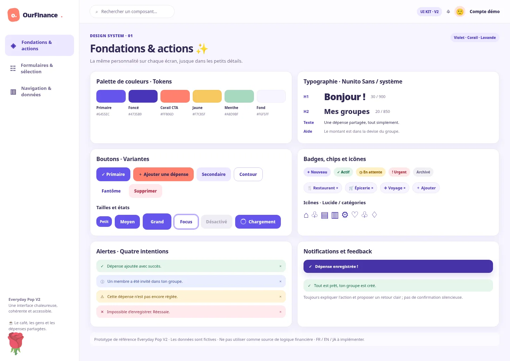
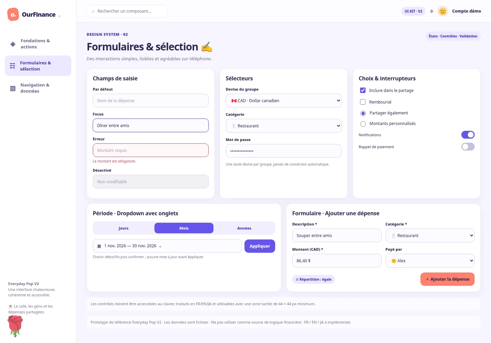
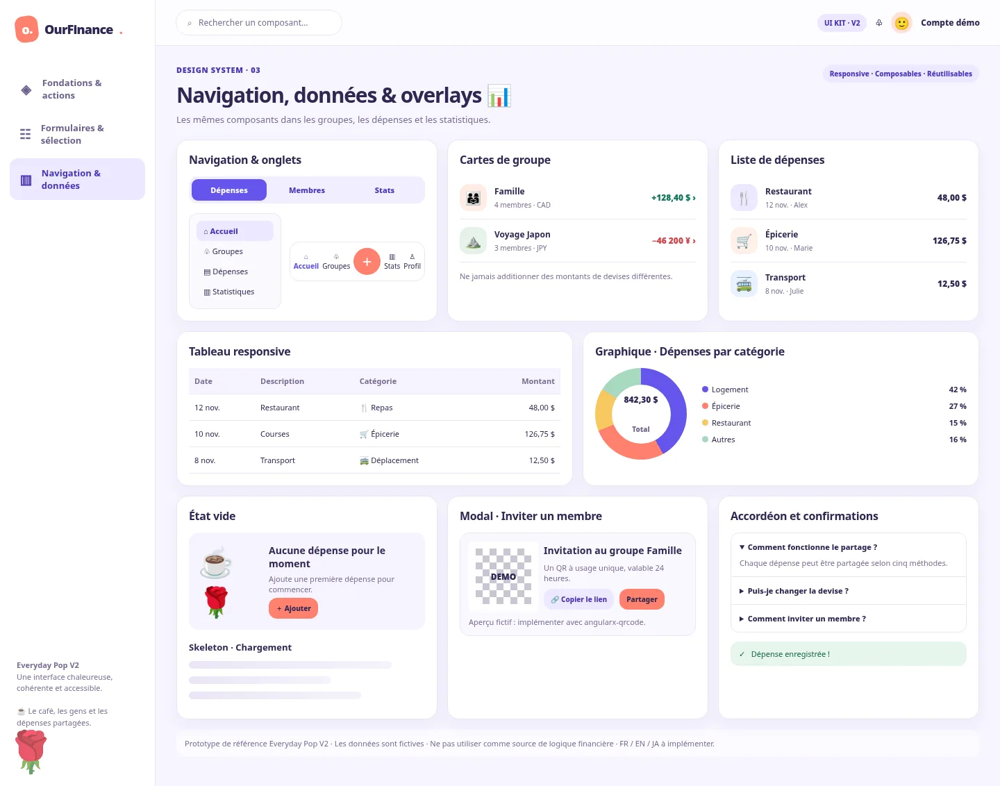

# OurFinance — UI Kit Everyday Pop V2 (proposition de référence)

**Date : 17 novembre 2026.** Catalogue visuel et interactif de **composants génériques et de leurs variants**, proposé pour guider Codex Cloud et Codex local. Ce n'est **pas** une implémentation Angular ni une validation de l'application existante.

**Source demandée** : [bibliothèque Emprez — UI Components](https://emprez-webapp-dev.azurewebsites.net/ui/components/#alert). **Limitation vérifiée** : cette page n'a pas pu être ouverte dans l'environnement de consultation ; **l'inventaire ci-dessous n'est pas un relevé d'Emprez**. Il s'agit d'un catalogue **OurFinance** conçu à partir des besoins fonctionnels et des [tokens Everyday Pop V2](../DESIGN_EVERYDAY_POP.md). Pour faire une correspondance composant par composant avec Emprez, fournir des captures ou un export de son inventaire.

## Consulter les trois écrans

- [Prototype HTML interactif](index.html) : ouvrir localement ; navigation via les trois onglets et paramètres `?screen=foundations`, `?screen=forms`, `?screen=data`.
- **Fondations & actions** : [desktop](screenshots/foundations-desktop.webp) · [mobile](screenshots/foundations-mobile.webp).
- **Formulaires & sélection** : [desktop](screenshots/forms-desktop.webp) · [mobile](screenshots/forms-mobile.webp).
- **Navigation, données & overlays** : [desktop](screenshots/data-desktop.webp) · [mobile](screenshots/data-mobile.webp).

**Important** : le HTML est un **prototype de référence**, avec données fictives, sans connexion Firebase, Worker ni Cloudinary. Les interactions de démonstration (tabs, switch, toast, accordéon) ne sont pas des composants de production. Le QR visuel est **fictif et non scannable** ; l'application doit utiliser `angularx-qrcode` conformément à `docs/INVITATIONS_QR.md`.

## Tokens de thème (à réutiliser, pas à recopier en dur)

| Rôle | Valeur | Usage |
|---|---|---|
| `pop-primary` | `#6455EC` | Action principale, focus, onglet actif |
| `pop-primary-dark` | `#4735B9` | Hover/texte actif |
| `pop-coral` | `#FF806D` | CTA « Ajouter », avec **texte foncé** |
| `pop-sun` | `#F7C85F` | Accent illustration, avertissement doux |
| `pop-mint` | `#A8D9BF` | Accents positifs |
| `pop-background` | `#F6F5FF` | Fond de page |
| `pop-surface` | `#FFFFFF` | Cartes et formulaires |
| `pop-text` | `#302752` | Texte principal |
| `pop-muted` | `#7B6C93` | Texte secondaire |
| `pop-border` | `#EAE6F5` | Bordures |
| `pop-lavender` | `#ECE8FF` | Fond secondaire |
| `pop-peach` | `#FFF0E9` | Fond corail clair |
| `pop-mint-soft` | `#E4F4EA` | Fond positif clair |

Les valeurs ci-dessus viennent du **design OurFinance déjà validé**, pas du site Emprez. Les styles doivent être centralisés dans `src/styles.css` et les composants Angular `shared`, sans CSS hexadécimal répété.

## Inventaire proposé des composants Angular et variants

| Composant réutilisable | Variants et états obligatoires | Usage OurFinance |
|---|---|---|
| `UiButton` | `primary`, `coral`, `secondary`, `outline`, `ghost`, `danger` ; `sm/md/lg` ; `hover`, `focus`, `disabled`, `loading` | Actions de groupe, dépense, invitation, sauvegarde |
| `UiAlert` | `success`, `info`, `warning`, `error` ; dismissible/non dismissible ; icône et actions facultatives | Confirmation, erreur réseau, invitation expirée |
| `UiBadge` / `UiChip` | neutral, active, pending, warning, danger ; chip removable/selectable | Catégories, filtres, statut d'invitation |
| `UiInput` / `UiTextarea` | normal, focus, invalid, disabled, readonly ; label, aide, message d'erreur | Login, dépense, profil |
| `UiSelect` | single, searchable (si utile), disabled, invalid ; clavier | Devise à la création d'un groupe, catégorie, payeur |
| `UiCheckbox` / `UiRadioGroup` / `UiSwitch` | checked, unchecked, disabled, invalid | Partage, préférences, notifications |
| `UiSegmentedControl` / `UiTabs` | 2–5 options, sélection, clavier, responsive | Répartition, onglets, Jours/Mois/Années |
| `UiPeriodRangePicker` | dropdown ; Jours, Mois, Années ; draft, apply/cancel, invalid range | Statistiques par plage inclusive |
| `UiCard` / `UiStatCard` | normal, interactive, selected, empty, loading | Dashboard, soldes, groupes |
| `UiGroupCard` / `UiExpenseRow` | devise unique du groupe, état du solde, icône de catégorie, skeleton | Groupes, historique |
| `UiTable` / `UiPagination` | loading, empty, sorted, overflow mobile | Historique, import/export, administration de groupe |
| `UiDonutChart` / `UiMemberBarChart` | tooltip, légende, vide, chargement, responsive | Statistiques, payé vs part attribuée |
| `UiDialog` / `UiPopover` / `UiTooltip` | open/close, focus trap, escape, backdrop, positionnement | Confirmation, aide, sélecteur de période |
| `UiToast` | success, error, info ; durée et fermeture ; annonce accessible | Sauvegarde, erreur, copie de lien |
| `UiAccordion` | single/multiple, expanded/collapsed | FAQ, détails secondaires |
| `UiEmptyState` / `UiSkeleton` | illustration facultative, CTA, chargement | Aucun groupe, aucune dépense, statistiques vides |
| `GroupInviteDialog` / `InviteQrCode` | pending, expired, revoked, used ; link + QR réel | Invitation de groupe sécurisée |
| `AppShell` / `BottomNavigation` | desktop/mobile, active, unauthenticated, zero groups | Navigation persistante |

### Ne pas créer un « composant générique » pour tout

- **Primitives** : Button, Alert, Input, Select, Card, Tabs, Dialog, Toast. API claire et composable.
- **Composants métier** : GroupCard, ExpenseRow, PeriodRangePicker, SplitEditor, InviteQrCode, DonutChart. Ils réutilisent les primitives mais restent dans des dossiers fonctionnels si leurs règles métier sont importantes.
- **Ne pas** créer de wrappers purement décoratifs, ni transformer un composant métier en « générique » avec des dizaines de propriétés booléennes. Préférer composition, slots et variants explicites.
- Conserver la séparation entre **présentation** et **services** (Firebase, Worker, calculs exacts), ainsi que l'architecture Angular standalone/Signals/Tailwind 4 existante.

## Contrat recommandé pour les variants

- Propriété `variant` typée (union string), `size` typée, `disabled`, `loading`, `ariaLabel` si icône seule, `class`/styles de composition limités ; événements de sortie standards Angular.
- Les variantes **doivent avoir une représentation dans le catalogue**, un test de rendu et des tests clavier.
- L'état `loading` ne doit pas déclencher deux soumissions ; l'état `disabled` est annoncé aux technologies d'assistance.
- `error` affiche un message relié au champ avec `aria-describedby` et `aria-invalid`, sans se limiter à la couleur.
- Les modales gèrent focus initial, piège à focus, Escape, fermeture et restitution du focus.
- Les composants sont localisés en **français, anglais et japonais**, sans textes codés en dur dans le composant réutilisable ; dates/montants utilisent `Intl` et **la devise fixe du groupe**.
- Taille tactile **≥ 44×44 px**, responsive 320/390/768/1280 px, contrastes WCAG, `prefers-reduced-motion`.

## Parcours de collaboration Codex Cloud / Codex local

1. **Source unique** : ce README, `index.html`, les 6 captures et `docs/DESIGN_EVERYDAY_POP.md` versionnés sur `main`. Le lien de la conversation ChatGPT est utile, mais **ne remplace pas des fichiers versionnés** ni la capacité de voir les images dans la tâche Codex.
2. **Cloud** : créer les **primitives** (`UiButton`, `UiAlert`, `UiInput`, `UiCard`, `UiTabs`, `UiDialog`, tokens) avec leurs variants et une page de catalogue Angular `/ui-kit` **réservée au développement**. Éviter les modifications des écrans métier en parallèle.
3. **Local** : après stabilisation des primitives, intégrer les **composants métier** (`GroupCard`, `ExpenseRow`, `PeriodRangePicker`, charts, InviteQrCode`) et migrer progressivement les écrans existants.
4. Travailler sur **branches/PR séparées** et vérifier les PR ouvertes avant d'éditer un même composant. Ne pas fusionner automatiquement ; la page `/ui-kit` doit être protégée/retirée de la production publique selon le besoin.
5. Chaque PR : captures Playwright desktop/mobile du composant et de ses variants, tests unitaires/a11y, `npm run typecheck`, build, tests existants ; **comparaison visuelle** avec ce kit et les maquettes V2 des écrans complets.
6. Ne pas confondre **maquette de composants** et **validation d'une fonctionnalité** : le design doit rester fidèle, mais les valeurs comptables, les permissions et les parcours QR viennent des services et du plan technique.

## Limite de la comparaison avec Emprez

Seule l'URL `.../ui/components/#alert` a été fournie. L'accès à cette page ayant échoué, **aucun nom de composant ou variant ci-dessus ne doit être présenté comme « observé chez Emprez »**. Dès réception de captures ou d'un export de la page, compléter un tableau `Emprez → OurFinance → variantes couvertes → écart à implémenter`.
